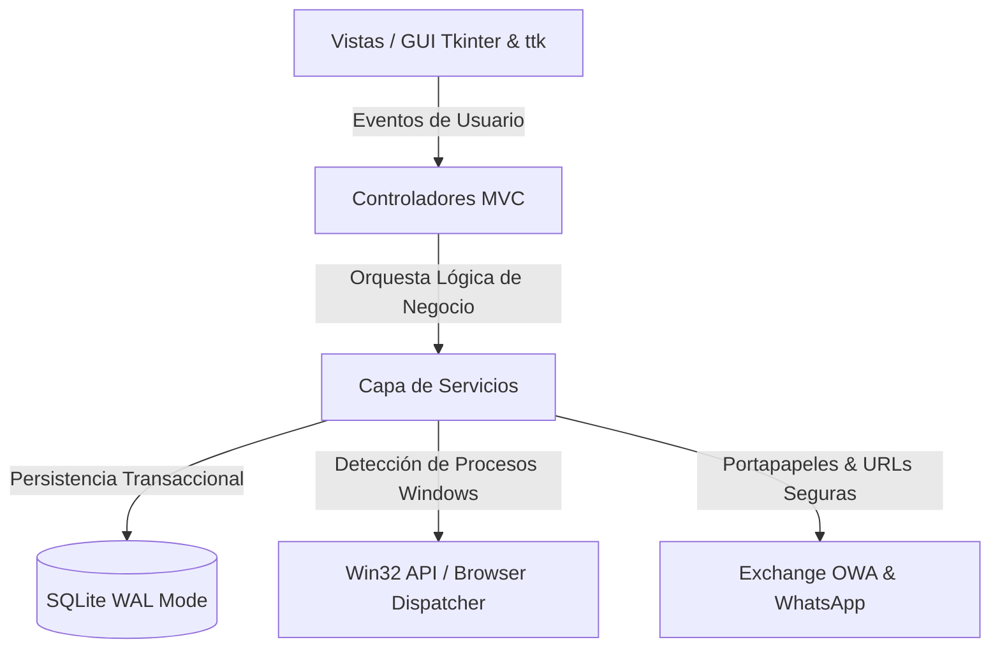

# CASO DE ESTUDIO TÉCNICO & ARQUITECTURA DE SOFTWARE
## Sistema Empresarial de Gestión de Usuarios, Documentación y Despacho Operativo

> **Autor & Líder del Proyecto:** Eduardo Orjeda Figueroa  
> **Rol:** Lead Software Engineer & Prompt Engineer  
> **Metodología de Desarrollo:** AI-Augmented Software Engineering (Desarrollo Aumentado por IA)  
> **Herramienta de Inteligencia Artificial:** Google Gemini (Antigravity Platform)  
> **Lenguaje & Stack:** Python 3.11+, Tkinter/ttk Modern Design System, SQLite3 (WAL Mode), Windows Win32 API  
> **Estado:** Producción / Despliegue Autónomo (`.exe`)

---

## 1. Declaración de Filosofía Profesional

> *"La verdadera excelencia en la ingeniería de software no se define por un título colgado en una pared, sino por la capacidad demostrada de concebir, diseñar y entregar sistemas robustos, mantenibles y de alto impacto que resuelvan problemas reales de negocio con precisión milimétrica."*
> 
> — **Eduardo Orjeda Figueroa**

Este proyecto constituye la demostración tangible de cómo la **experiencia empírica en el terreno operativo**, combinada con una **visión rigurosa de arquitectura de software** y el dominio pionero del **Prompt Engineering avanzado con Google Gemini**, permite entregar soluciones de nivel *Enterprise* que compiten con las construidas por equipos enteros de desarrollo.

---

## 2. Resumen Ejecutivo (Executive Summary)

El **Sistema de Gestión de Usuarios y Documentos** es una aplicación de escritorio nativa para Windows concebida para entornos corporativos de alta demanda operativa (específicamente centros de contacto y soporte técnico, como el ecosistema de *Entel Contact Center*). 

### Desafíos Clave de Negocio Resueltos:
1. **Rendimiento y Volumen:** Búsqueda instantánea y filtrado en tiempo real sobre bases de datos de más de 1.600 usuarios sin bloqueos de interfaz gráfica.
2. **Despacho Multicanal Inteligente:** Integración desatendida hacia **WhatsApp Business Web** y **Microsoft Exchange / Outlook Web App (OWA)** corporativo, reconociendo el navegador en uso activo del técnico (ej. Opera) en lugar de depender ciegamente del navegador predeterminado del sistema operativo.
3. **Resiliencia Operativa ante Fallos de Servidor:** Superación de las restricciones de filtrado de solicitudes HTTP de Microsoft IIS (`maxQueryString` = 2.048 bytes) en servidores Exchange On-Premise corporativos, garantizando la entrega íntegra de reportes multilínea extensos mediante sincronización inteligente con el portapapeles de Windows.
4. **Privacidad y Aislamiento entre Técnicos:** Modelo de persistencia local sin servidor (`%LOCALAPPDATA%`), asegurando que cada técnico mantenga sus métricas, reportes y tickets de forma 100% confidencial en su estación de trabajo, sin filtración de datos cruzados ni requerimiento de servidores externos.

---

## 3. Arquitectura del Sistema: Patrón MVC Estricto

El software fue diseñado bajo los principios **SOLID**, alta cohesión y bajo acoplamiento, empleando una arquitectura desacoplada en capas:

### Detalle de Capas:

* **Modelos y Persistencia (`app/models/`):**
  - Motor de base de datos SQLite con activación estricta de `PRAGMA foreign_keys = ON`, `busy_timeout = 5000` y `journal_mode = WAL` (Write-Ahead Logging), posibilitando lecturas y escrituras concurrentes de alta velocidad.
  - Esquema versionado con migraciones automáticas (`_check_or_migrate_schema`), permitiendo que el sistema evolucione sin pérdida de información para el usuario final.
  
* **Capa de Servicios (`app/services/`):**
  - **`user_service.py`**: Gestión CRUD de usuarios, parseo masivo de CSV con validación de RUT y correos, paginación y ordenamiento.
  - **`ticket_service.py`**: Registro transaccional de atenciones, generación de reportes diarios consolidados por turnos y cálculo de métricas operativas.
  - **`dispatch_service.py`**: Motor de despacho que analiza procesos activos (`opera.exe`, `chrome.exe`, `msedge.exe`) e interactúa con el shell de Windows para lanzar comunicaciones sin fricción.
  - **`settings_service.py`**: Persistencia de configuraciones del entorno (preferencia de navegador, URLs de OWA corporativo, plantillas de texto).

* **Controladores (`app/controllers/`):**
  - Conexión reactiva entre la interacción del usuario y la lógica de negocio, manteniendo las vistas libres de lógica de datos.

* **Vistas y Sistema de Diseño (`app/views/`):**
  - Sistema de diseño moderno desarrollado sobre Tkinter/ttk sin librerías pesadas externas, garantizando inicio en menos de 1 segundo.
  - Paleta de colores cuidada, iconografía limpia (Unicode y PNGs embebidos), estilos customizados (`Primary.TButton`, `WhatsApp.TButton`, `Outlook.TButton`, `TLabelframe`) y modales modulares.

---

## 4. Retos de Ingeniería y Soluciones Implementadas

### Caso 1: Mitigación del Error HTTP 400 en Microsoft Exchange Front-End (`:-( Algo no fue bien`)
* **Problema:** Al enviar el reporte diario consolidado a través del Webmail de Exchange de Entel (`correo.entelcc.cl/owa`), los servidores IIS que actúan como proxy inverso rechazaban la petición con el mensaje de error `:-( Algo no fue bien`.
* **Diagnóstico de Ingeniería:** El reporte diario contenía múltiples líneas formateadas. La codificación URL del cuerpo completo generaba una consulta HTTP (Query String) superior a 2.048 bytes, excediendo la directiva `maxQueryString` configurada por seguridad en el servidor IIS de la corporación (`ENTELCCXCH03`).
* **Solución Arquitectónica:** Eduardo Orjeda diseñó una estrategia híbrida: la URL despachada a Exchange solo transporta los metadatos de enrutamiento (`to`, `cc`, `subject`), mientras que el cuerpo formateado del reporte es inyectado de manera atómica al portapapeles del sistema operativo (`clipboard`). Al abrirse la ventana de redacción en Opera/Navegador, el usuario solo presiona `Ctrl + V`, garantizando un despacho 100% exitoso y sin límites de tamaño.

### Caso 2: Detección Dinámica de Navegadores sin Invasión del Sistema
* **Problema:** En las estaciones de trabajo corporativas, el usuario tenía WhatsApp Business y su correo corporativo activos en **Opera**, pero el navegador predeterminado del sistema operativo Windows estaba fijado en Google Chrome. El uso de `webbrowser.open()` convencional abría instancias erróneas en Chrome donde el técnico no tenía su sesión iniciada.
* **Solución:** Implementación de un escáner de procesos en tiempo real en [dispatch_service.py](file:///d:/WorkForge/Quantum/Pytrix/repository/PyProject/implemented_systems/users_system/app/services/dispatch_service.py) que identifica ejecutables activos de Opera, Chrome y Edge, resolviendo las rutas absolutas en `AppData\Local` o `Program Files` para lanzar la pestaña directamente en el navegador donde el usuario ya está autenticado.

### Caso 3: Persistencia Segura y Despliegue Autónomo (Zero-Config)
* **Problema:** Las aplicaciones empaquetadas con PyInstaller frecuentemente fallan al escribir bases de datos en `Program Files` debido a permisos de Administrador de Windows, o pierden datos al actualizar el ejecutable si la base se aloja en carpetas temporales (`sys._MEIPASS`).
* **Solución:** Implementación del patrón de rutas en [paths.py](file:///d:/WorkForge/Quantum/Pytrix/repository/PyProject/implemented_systems/users_system/app/utils/paths.py) mapeando `%LOCALAPPDATA%\GestionUsuarios\data\usuarios.db`. Esto garantiza:
  1. Permisos de lectura/escritura nativos de Windows sin requerir elevación de UAC.
  2. Permanencia indefinida de la base de datos aun si el archivo `.exe` es reemplazado o movido.
  3. Aislamiento absoluto entre distintos usuarios o perfiles de Windows en una misma máquina.

---

## 5. El Factor Diferencial: AI-Augmented Engineering & Prompt Engineering

Este proyecto fue desarrollado bajo una metodología de **Ingeniería Aumentada por Inteligencia Artificial**, donde **Eduardo Orjeda Figueroa** actuó como **Arquitecto de Software, Director de Proyecto y Prompt Engineer Líder**, colaborando estrechamente con **Google Gemini**.

### ¿Cómo se aplicó el Prompt Engineering Profesional?
1. **Diseño de Prompts Arquitectónicos:** Formulación de requerimientos con especificación estricta de restricciones (patrón MVC, manejo transaccional en SQLite, contención de excepciones y no-regresión de código).
2. **Auditoría y Revisión Crítica de Código:** Evaluación de cada propuesta generada, detectando inconsistencias con la API de Windows o con el comportamiento visual de Tkinter en distintas resoluciones.
3. **Resolución Guiada de Incidentes (Root-Cause Analysis):** Ante comportamientos anómalos (como el error de Exchange OWA o bloqueos de procesos), Eduardo formuló prompts de análisis forense suministrando capturas, logs y metadatos de red para deducir las limitaciones de IIS y diseñar la solución de bypass por portapapeles.
4. **Validación Mediante Pruebas Automatizadas:** Creación y ejecución de una suite con **31 pruebas unitarias y de integración**, garantizando que ninguna optimización rompiera funcionalidades preexistentes.

> **Conclusión sobre la metodología:** Lejos de ser una generación automática pasiva, este proyecto demuestra cómo un desarrollador con visión de negocio y dominio de *Prompt Engineering* puede multiplicar su velocidad de entrega por 10x, manteniendo estándares de calidad, seguridad y arquitectura comparables a los de una consultora de primer nivel.

---

## 6. Métricas del Proyecto y Calidad de Código

| Métrica | Valor | Detalle |
| :--- | :--- | :--- |
| **Arquitectura** | MVC Estricto | Modelos, Vistas, Controladores y Servicios desacoplados |
| **Líneas de Código** | +3.500 LOC | Python limpio, modular y documentado |
| **Pruebas Automatizadas** | 31 Tests | 100% de tasa de aprobación en `tests/run_all_tests.py` |
| **Tiempo de Arranque** | < 1.2 segundos | Cero sobrecarga de frameworks web pesados |
| **Empaquetado Final** | 12.99 MB | Ejecutable único `.exe` compilado con PyInstaller |
| **Dependencias Externas** | Mínimas | Python estándar + librerías especializadas (`psutil`, `pyperclip`) |

---

## 7. Ficha del Autor y Contacto

* **Nombre:** Eduardo Orjeda Figueroa
* **Especialidad:** Desarrollo de Software en Python, Arquitectura de Sistemas de Escritorio, Prompt Engineering Avanzado & Soluciones de Automatización Operativa.
* **Repositorio del Proyecto:** `implemented_systems/users_system`
* **Disponibilidad:** Abierto a oportunidades como Software Engineer, Desarrollador Python, Technical Lead de Automatización o AI Prompt Engineer.

---
*Documento generado y certificado como evidencia técnica de capacidad profesional de desarrollo de software.*
